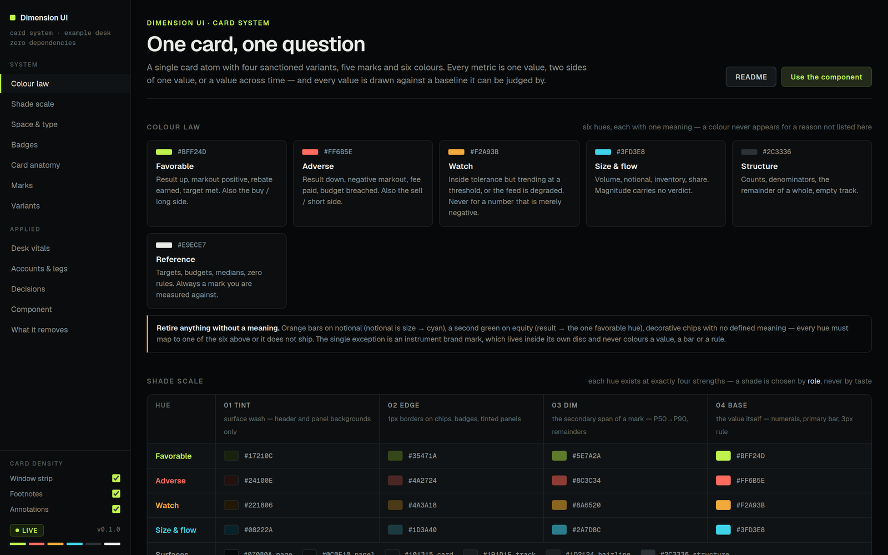
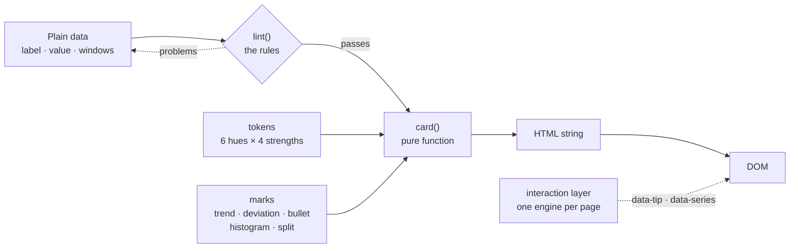
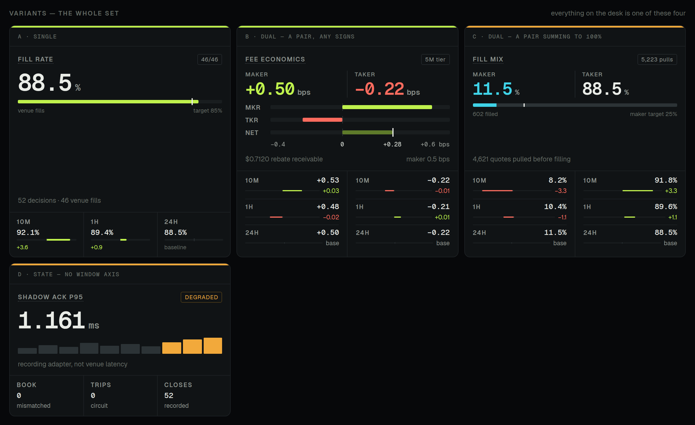
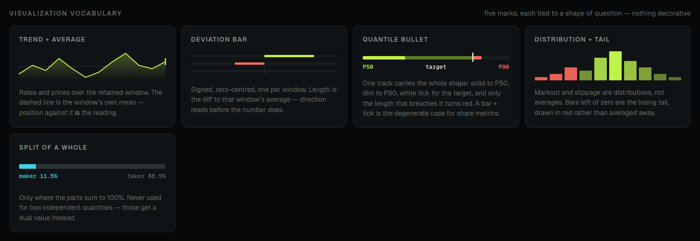
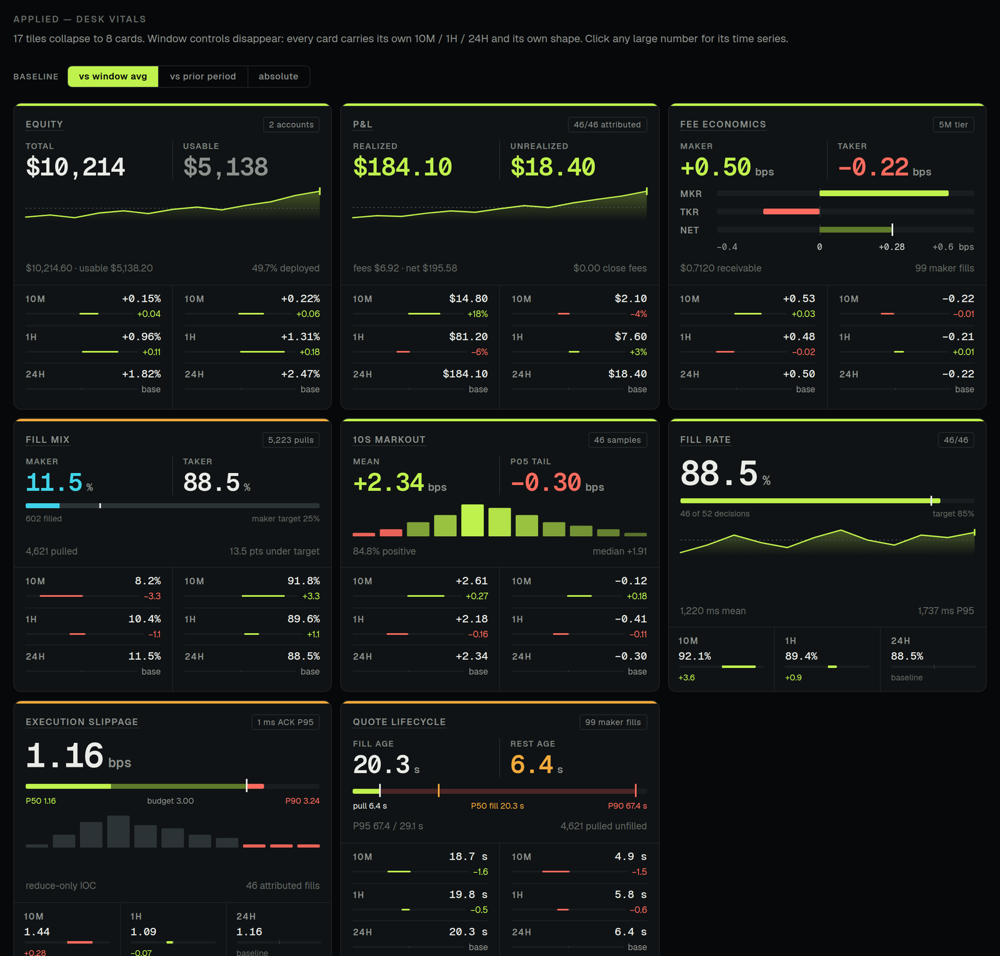
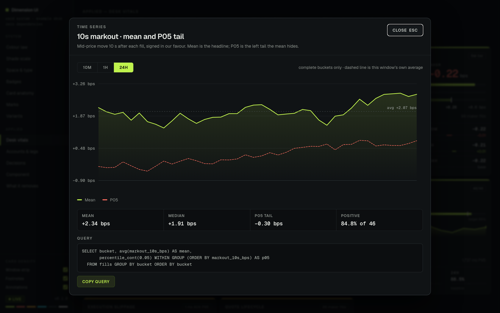

<div align="center">

# Dimension UI

### A rules-first card system for dense, high-stakes interfaces

**One card, one question** · six colours with one meaning each · five marks · four variants · zero dependencies

[](https://www.npmjs.com/package/@dabaihk/dimension-ui)
[](LICENSE)
[](package.json)
[](src)
[](src/index.js)
[](package.json)
[](AGENTS.md)

[**Live demo**](https://dabaihk.github.io/dimension-ui/docs/) · [**Quick start**](#quick-start) · [**The system**](#the-system) · [**API**](#api-reference) · [**Agents**](#built-for-agents) · [**Docs**](#documentation)

<br>



</div>

<br>

## Why Dimension UI

> **Interfaces are getting more complicated faster than our tools for building them.**

AI makes the cost of producing a screen close to zero. Agents scaffold a dashboard in seconds, every system exports a hundred metrics, and one view now has to carry what used to take ten. Toolkits answered that with more **components**: another card, another chart, another badge. They leave the **judgement** to taste, and at this density taste doesn't scale. Each new tile picks its own colour, its own scale and its own idea of "good". The screen fills up, and nobody can read it.

Dimension UI is built the other way round. **The rules come first; the components are how the rules get enforced.**

<table>
<tr>
<td width="50%" valign="top">

**A colour means one thing, everywhere.**
Six hues, each bound to one meaning. A hue that doesn't map to one of them doesn't ship.

**A shade is chosen by role, never by taste.**
Every hue exists at exactly four strengths: tint, edge, dim, base.

**Every value is judged against a baseline.**
A bare number can't be read. Each card carries its own shape and its own window strip.

</td>
<td width="50%" valign="top">

**Time is an axis, not a card.**
10M / 1H / 24H live *inside* the card. Four metrics never become sixteen tiles.

**Two values only when they answer one question.**
Maker ↔ taker, mean ↔ tail, on one shared signed axis and never mirrored.

**The rules are executable.**
`lint(card)` returns every rule a card breaks, for reviewers, CI and agents.

</td>
</tr>
</table>

<br>

## At a glance

| | | |
|:--|:--|:--|
| **6** hues with fixed meanings | **4** strengths per hue, chosen by role | **5** marks, each tied to a question |
| **4** card variants: the whole set | **1** page-wide interaction engine | **0** runtime dependencies, no build step |

<br>

## Quick start

```bash
npm install @dabaihk/dimension-ui
```

```html
<link rel="stylesheet" href="node_modules/@dabaihk/dimension-ui/src/tokens.css">
<link rel="stylesheet" href="node_modules/@dabaihk/dimension-ui/src/dimension.css">
```

```js
import { card, marks, lint } from '@dabaihk/dimension-ui';

const fillRate = {
  label: 'Fill rate',                              // the question, 2–3 words
  tip:   'Venue fills ÷ decisions dispatched.',    // hover definition
  tone:  'favorable',
  chip:  '46/46',
  value: { v: '88.5', unit: '%', series: 'fillrate' },
  marks: marks.meter({ value: 88.5, target: 85 }),
  windows: [
    { win: '10M', rows: [{ v: '92.1%', d: '+3.6', w: 0.8, dir: 1 }] },
    { win: '1H',  rows: [{ v: '89.4%', d: '+0.9', w: 0.2, dir: 1 }] },
    { win: '24H', rows: [{ v: '88.5%' }] }         // the baseline
  ],
  foot: ['52 decisions', '1,737 ms P95']
};

lint(fillRate);                     // → []   it ships
grid.innerHTML = card(fillRate);    // an HTML string: any framework, or none
```

Every component is a **pure function that returns an HTML string**. The same call works in the browser, in a server template, in React through `dangerouslySetInnerHTML`, or in a file an agent writes.

<br>

## Architecture



| Layer | File | Responsibility |
|:--|:--|:--|
| Tokens | `src/tokens.css` · `src/tokens.js` | The colour law, shade scale, surfaces, type, space, shape. CSS custom properties and a JS mirror kept in lock-step by tests. |
| Marks | `src/marks.js` | The visualization vocabulary as SVG and HTML string builders. |
| Card | `src/card.js` | The card atom, its four variants, the window strip, and `lint()`. |
| Badges | `src/badges.js` | Side, direction, state, instrument, chip. |
| Interaction | `src/interact.js` | Global tooltips, click-to-enlarge time series, scroll spy. |
| Element | `src/element.js` | Optional `<dx-card>` custom element for declarative use. |

<br>

## The system

### Colour law

| | Tone | Means | Never |
|:--:|:--|:--|:--|
|  | `favorable` · `#BFF24D` | Result up, markout positive, target met. Also the **buy / long** side. | A second, decorative green. |
|  | `adverse` · `#FF6B5E` | Result down, fee paid, budget breached. Also the **sell / short** side. | Emphasis for its own sake. |
|  | `watch` · `#F2A93B` | Inside tolerance but trending at a threshold, or a degraded feed. | A number that is merely negative. |
|  | `flow` · `#3FD3E8` | Volume, notional, inventory, share: magnitude with **no verdict**. | Good or bad. |
|  | structure · `#2C3336` | Counts, denominators, remainders, empty track. | A result. |
|  | reference · `#E9ECE7` | Targets, budgets, medians, zero rules. | A measurement. |

The one sanctioned exception is an **instrument brand mark**. Its colour lives inside its own disc and never reaches a value, a bar or a rule.

### Shade scale

Each hue exists at exactly four strengths, chosen by **role**:

| Strength | Role | CSS |
|:--|:--|:--|
| `tint` | Surface wash: header and panel backgrounds only | `--dx-fav-tint` |
| `edge` | 1px borders on chips, badges, tinted panels | `--dx-fav-edge` |
| `dim` | The secondary span of a mark: P50 → P90, remainders | `--dx-fav-dim` |
| `base` | The value itself: numerals, primary bar, status rule | `--dx-fav` |

### Variants: the whole set



| Variant | Use when | Strip |
|:--|:--|:--|
| `single` | One number answers the question | One window per column |
| `dual` | A pair with independent signs (realized / unrealized, mean / tail) | Two columns, windows stacked |
| `split` | A pair that sums to 100% | Two columns, windows stacked |
| `state` | A status or latency with no meaningful time axis | `facts` replace windows |

### Marks: the visualization vocabulary



| Mark | Shape of question | Rule |
|:--|:--|:--|
| `trend` | Rates and prices over time | The dashed line is the window's own mean. Position against it *is* the reading. |
| `deviation` | Each window vs. its average | Signed and zero-centred. Direction reads before the number does. |
| `bullet` | Quantiles against a budget | Solid to P50, dim to P90, white target tick. Only the breach turns red. |
| `histogram` | Distributions with a losing tail | The tail is drawn red, not averaged away. |
| `split` | Parts of a whole | Only when the parts sum to 100%. |

### Applied: a live desk



<br>

## The interaction layer

One engine for the whole page. Nothing is wired per component; any element opts in with an attribute.

| Attribute | Behaviour |
|:--|:--|
| `data-tip="…"` | Hover or focus shows the definition. A dotted underline means a definition is waiting. |
| `data-series="key"` | Click, <kbd>Enter</kbd> or <kbd>Space</kbd> opens the enlarged time series: window tabs, crosshair readout, full-precision rows and a copyable query. <kbd>Esc</kbd> closes it. |

```js
import { register } from '@dabaihk/dimension-ui';

register({
  fillrate: {
    label: 'Fill rate', unit: '%',
    lines: [{ k: 'Fill rate', color: '#bff24d', windows: { '10M': [...], '1H': [...], '24H': [...] } }],
    rows:  [['Target', '85.0%'], ['P95 ACK', '1,737 ms']],
    query: 'SELECT bucket, avg(filled) FROM decisions GROUP BY bucket'
  }
});
```



<br>

## Built for agents

Generated UI fails in a predictable way: every element is reasonable on its own, and the whole is unreadable. Dimension UI gives an agent a **closed vocabulary** and a **checker**:

```js
lint({ label: 'Maker fill age by venue', variant: 'split',
       values: [{ v: '40%' }, { v: '40%' }], tinted: true });
```

```text
label: "Maker fill age by venue" is 5 words; keep it to two or three and move qualifiers to the footnote
tip: missing — every label carries its definition on hover
variant: split values sum to 80, not 100 — use "dual"
tinted: a card earns a tint only when its identity is a side or a state — give it a tag
strip: no windows — every value is judged against a baseline
```

- **Closed vocabulary:** `tone()` throws on any hue outside the law, and `card()` refuses a third value.
- **Machine-readable brief:** [`AGENTS.md`](AGENTS.md) is the one-page contract to hand any coding agent.
- **Declarative surface:** `<dx-card>` takes JSON, so an agent can emit markup without writing code.

```html
<script type="module" src="node_modules/@dabaihk/dimension-ui/src/element.js"></script>
<dx-card><script type="application/json">
  { "label": "Fill rate", "tip": "Venue fills ÷ decisions.",
    "value": { "v": "88.5", "unit": "%" },
    "marks": { "mark": "meter", "args": [{ "value": 88.5, "target": 85 }] },
    "windows": [ … ] }
</script></dx-card>
```

<br>

## API reference

<details open>
<summary><b><code>card(options)</code> → <code>string</code></b></summary>

| Option | Type | Description |
|:--|:--|:--|
| `label` | `string` | **Required.** The question, in 2–3 words. |
| `tip` | `string` | Hover definition, including the denominator. |
| `tone` | `Tone` | Status rule colour. Default `neutral`. |
| `chip` | `string \| { label, tone?, dot? }` | Denominator, tier or state word in the head. |
| `tag` · `tinted` | `string` · `boolean` | Identity tag; tint the head only when identity *is* a side or a state. |
| `variant` | `'single' \| 'dual' \| 'split' \| 'state'` | Inferred when omitted. |
| `value` · `values` | `Value` · `[Value, Value]` | `{ sub?, v, unit?, tone?, muted?, series?, better?, aside? }` |
| `marks` | `raw(html) \| raw[]` | Any mark output. |
| `windows` | `Window[]` | `{ win, tip?, rows: [{ v, d?, w?, dir?, better?, tone? }] }`. `w` is in [0, 1] of the half track. |
| `facts` | `Fact[]` | State strip: `{ k, v, note?, tone?, bar? }`. |
| `better` | `'up' \| 'down'` | Use `'down'` for costs and latencies, where a rise is adverse. |
| `foot` | `[left, right]` | Footnotes: basis and coverage. |
| `caption` · `span` · `id` · `attrs` | | Caption bar, 2-column span, element id, extra attributes. |

</details>

<details>
<summary><b>Marks</b></summary>

| Function | Signature |
|:--|:--|
| `trend` | `(values: number[], { tone?, height? })` |
| `deviation` | `({ w, dir, better?, tone?, size?: 'thin' \| 'normal' \| 'thick' })` |
| `bullet` | `({ p50, p90, target, max, min?, better? })` |
| `histogram` | `(bins: number[], { split, mode?: 'gain' \| 'cost', height?, gap? })` |
| `split` | `({ parts: [{ value, tone? }], target?, tall? })` |
| `meter` | `({ value, target?, max?, min?, tone? })` |
| `range` | `({ segments: [{ from, to, tone \| color }], ticks: [{ at, tone?, tip? }] })` |
| `pairedAxis` | `({ rows: [{ k, value, tone?, strength?, tick? }], min, max, scale? })` |
| `diverging` | `({ left: { value, target?, tip? }, right: { … }, max })` |
| `band` | `({ value, tol, max })` |
| `columns` · `rail` · `scaleRow` | Small helpers for state cards, ranked bins and axis labels. |

</details>

<details>
<summary><b>Badges</b></summary>

| Function | Use |
|:--|:--|
| `side('long' \| 'short' \| 'flat')` | What is held. Word-set with a locked width. |
| `direction('buy' \| 'sell')` | A momentary action. Square glyph. |
| `state(label, { tone?, dot? })` | Where something is in its life. Only live states earn colour. |
| `instrument(ticker, { kind?, color?, glyph?, svg? })` | Brand disc plus ticker. |
| `chip(label, { tone?, dot? })` · `badge(label, { tone?, dot? })` | Small bordered chips and plain toned badges. |

</details>

<details>
<summary><b>Tokens, rules &amp; interaction</b></summary>

| Export | Description |
|:--|:--|
| `TONES` · `SURFACE` · `MEANING` | The colour law as data. |
| `tone(name)` · `toneKey(name)` | Resolve a tone or alias (`lime`, `red`, `amber`, `cyan`). Throws outside the law. |
| `isLawful(hex)` | True when a colour belongs to the system. |
| `verdict(dir, better)` | `favorable` / `adverse` / `neutral` for a signed change. |
| `lint(options)` | The rules a card breaks, as a list of strings. |
| `register(map)` · `open(cfg)` · `close()` | The time-series engine. |
| `scrollSpy(root)` | Marks the nav link whose section is in view with `aria-current`. |
| `fmt(v, unit)` · `gen(seed, n, start)` | Formatting, plus a deterministic demo series generator. |
| `raw(html)` · `esc(text)` | Trusted-HTML slots and escaping. All text inputs are escaped by default. |

</details>

<br>

## Design ladders

| Type | | Space | | Shape | |
|:--|--:|:--|--:|:--|--:|
| Primary value | `41 / 30` | Section gap | `38` | Radius card · panel · badge · glyph | `10 / 8 / 4 / 3` |
| Money row | `17` | Card gutter | `10` | Status rule · hairline | `3 / 1` |
| Data | `13 / 12.5` | Card padding | `13 / 14` | Bars: deviation · bullet · axis | `2 / 6 / 7` |
| Label | `11 / 10.5` | Row rhythm | `34` | Hover affordance | dotted |
| Families | Geist · Geist Mono | Min column | `292` | Click affordance | pointer |

<br>

## Documentation

**[Live demo → dabaihk.github.io/dimension-ui/docs](https://dabaihk.github.io/dimension-ui/docs/)**

[`docs/index.html`](docs/index.html) is the full specification, **rendered by the library itself**: colour law, shade scale, ladders, badges, anatomy, marks, variants, and an applied desk with vitals, accounts and legs, and a decisions blotter. Density toggles show the cards with and without strips, footnotes and annotations.

```bash
git clone https://github.com/dabaihk/dimension-ui && cd dimension-ui
npm run dev            # → http://127.0.0.1:4173/docs/
```

To run it locally, serve it: ES modules don't load from `file://`. All figures on it are illustrative demo data.

<br>

## Project layout

```text
dimension-ui/
├── src/
│   ├── tokens.css      the law as CSS custom properties
│   ├── tokens.js       the law as data · tone() · isLawful() · verdict()
│   ├── dimension.css   component styles
│   ├── card.js         card() · windowStrip() · facts() · lint()
│   ├── marks.js        trend · deviation · bullet · histogram · split · composites
│   ├── badges.js       side · direction · state · instrument · chip
│   ├── interact.js     tooltips · time-series engine · scroll spy
│   ├── element.js      <dx-card>
│   └── index.js
├── docs/               the living specification
├── test/               node:test suites
├── AGENTS.md           the brief for coding agents
└── LICENSE             MIT
```

<br>

## Development

```bash
npm test               # node:test, no dependencies
npm run dev            # zero-dependency static server for the docs
```

**Browser support:** evergreen browsers with ES modules and CSS custom properties. **Fonts:** [Geist and Geist Mono](https://vercel.com/font) (SIL OFL) are the intended faces; any sans and mono pair works.

## Contributing

Issues and pull requests are welcome. One rule governs every change: **a new metric picks from the existing marks and hues, or it makes the case for changing the law.** Nobody adds a seventh colour quietly.

## License

[MIT](LICENSE) © Dimension UI contributors

<div align="center">
<br>
<sub>Built for the era where interfaces are generated faster than they can be read.</sub>
</div>
